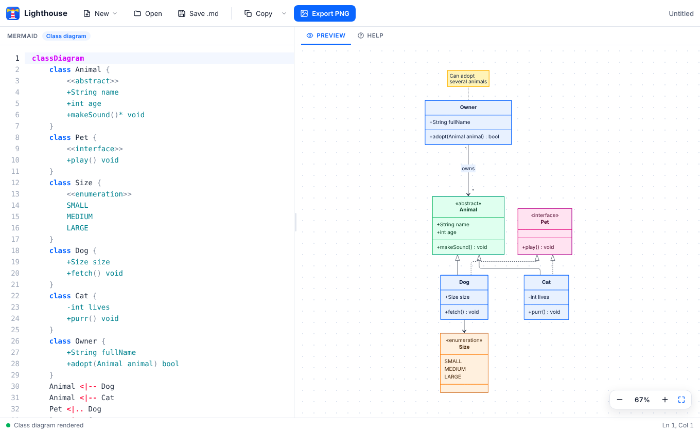

# Lighthouse

A desktop editor for UML diagrams written in [Mermaid](https://mermaid.js.org): type the code on the left, see the diagram on the right. Linux and Windows.



## Features

- **Live preview** with zoom, pan and fit-to-view, refreshed as you type. Errors are shown in the preview and highlighted on the faulty line.
- **Diagram types**: class, sequence, use case, state and activity, each with a template in the **New** menu. Other Mermaid types (ER, Gantt...) render too.
- **One color per item type**: classes, interfaces, abstract classes, enumerations, actors, notes, decisions, containers... each have their own color, in every diagram.
- **Help tab** (F1) for the current diagram type: syntax reminders, snippets to insert in one click, color legend, keyboard shortcuts.
- **Editor**: syntax highlighting, line numbers, undo/redo, auto-indent, comment / duplicate / move / delete lines.
- **Markdown files**: open a `.md` file to edit its first ` ```mermaid ` block. Saving rewrites only that block and keeps the rest of the document.
- **Export**: save as `.md`, copy the code or a Markdown block, export the diagram as PNG.
- **Customizable** colors, fonts and export settings in a commented `config.toml`.
- Works offline: Mermaid is bundled.

## Install

Download the latest version from the [Releases](../../releases/latest) page.

**Windows 10 / 11**: run `Lighthouse_<version>_x64-setup.exe`. No administrator rights are needed.
The installer is not signed yet: if SmartScreen warns you, click *More info*, then *Run anyway*.
Lighthouse uses Microsoft Edge WebView2, which comes with Windows 10/11. If it is missing, the installer downloads it.

**Linux (Debian, Ubuntu and derivatives)**

```bash
sudo apt install ./Lighthouse_<version>_amd64.deb
```

**Linux (any distribution)**

```bash
chmod +x Lighthouse_<version>_amd64.AppImage
./Lighthouse_<version>_amd64.AppImage
```

### Update or uninstall

| | Update | Uninstall |
|---|---|---|
| Windows | Run the new installer | *Settings > Apps > Installed apps > Lighthouse > Uninstall* |
| .deb | `sudo apt install ./Lighthouse_<new>_amd64.deb` | `sudo apt remove lighthouse` |
| AppImage | Replace the file | Delete the file |

Your settings are kept in both cases. To remove them too, delete the configuration folder listed below.

## Usage

The first line of the code sets the diagram type:

| Diagram | First line |
|---|---|
| Class | `classDiagram` |
| Sequence | `sequenceDiagram` |
| Use case | `usecase-beta` (Mermaid beta syntax) |
| State | `stateDiagram-v2` |
| Activity | `flowchart TD` (flowchart syntax with UML shapes) |

Main shortcuts: **F1** help, **Ctrl+N** new, **Ctrl+O** open, **Ctrl+S** save, **Ctrl+E** export PNG, **Ctrl+Z** / **Ctrl+Shift+Z** undo / redo. The help tab lists all of them.

A file can be opened from the command line: `lighthouse diagram.md`.

## Customize

On first launch Lighthouse writes its configuration, with every setting commented, to:

- Windows: `%APPDATA%\Lighthouse\config.toml`
- Linux: `~/.config/lighthouse/config.toml`

Edit it, then press **Ctrl+R** in Lighthouse to apply it. Only the keys you change are needed. Invalid keys or values are reported and the defaults are used instead.

## Build from source

Requirements: [Rust](https://rustup.rs) (stable), [Node.js](https://nodejs.org) 18 or later, and the system dependencies of Tauri:

- **Windows**: Microsoft C++ Build Tools ("Desktop development with C++") and WebView2 (already on Windows 10/11).
- **Linux (Debian/Ubuntu)**:
  `sudo apt install libwebkit2gtk-4.1-dev build-essential file libxdo-dev libssl-dev libayatana-appindicator3-dev librsvg2-dev`

```bash
git clone https://github.com/<owner>/lighthouse.git
cd lighthouse
npm install
npm run dev      # run in development mode
npm run build    # installers in src-tauri/target/release/bundle/
```

On Windows `npm run build` produces the `.exe` installer; on Linux, the `.deb` and the `.AppImage`.

## Contributing

Contributions are welcome. See [CONTRIBUTING.md](CONTRIBUTING.md) for the project layout, the checks to run and how to publish a release. Changes are listed in [CHANGELOG.md](CHANGELOG.md).

## License

[MIT](LICENSE). Mermaid is distributed under the MIT license.
